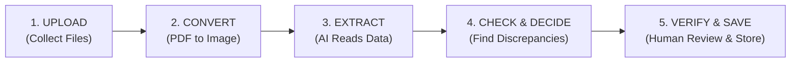
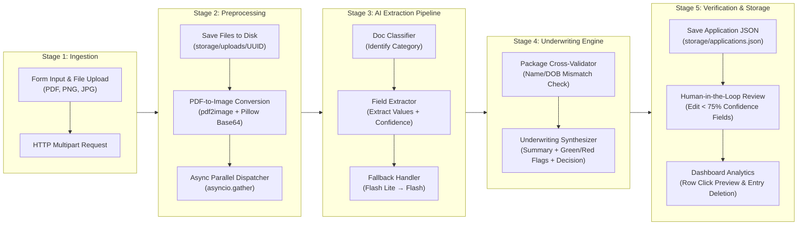

# 🏦 LoanIQ - Intelligent Loan Application Processor

An end-to-end, AI-powered document processing and loan underwriting system built with **Google Gemini AI**, **LangChain**, **FastAPI**, and **Streamlit**. 

LoanIQ automatically classifies uploaded loan application documents (Payslips, Tax Forms, PAN Cards, Aadhaar Cards, Driving Licenses, Bank Statements, Form 16, ITR), extracts key financial and personally identifiable information (PII), performs automated cross-validation across documents to detect inconsistencies or identity mismatches, and generates a comprehensive AI underwriting report featuring **Positive Highlights (Green Flags 🟢)** and **Risk Factors (Red Flags 🔴)** with approval recommendations. It also features an interactive **Human-in-the-Loop** verification interface and a **Dashboard** with **single continuous row click preview** and **individual entry deletion**.

---

## 📁 Project Directory Structure

```text
Loan-Documents-Processing-using-GEN-AI/
├── .env                    # Secret environment file storing GEMINI_API_KEY (ignored by Git)
├── .gitignore              # Git exclusion file ignoring secrets, cache, and uploaded files
├── .streamlit/
│   └── config.toml         # Custom Streamlit theme configuration (White canvas, Executive Dark Blue accents)
├── README.md               # Complete project documentation & system guide
├── app.py                  # Streamlit frontend app (LoanIQ UI, Dashboard, Row Click Preview, HITL Verification)
├── env.example             # Template file reference for environment variables
├── gen_workflow_img.py     # Utility script to generate technical workflow & architecture diagrams
├── main.py                 # FastAPI backend server (Gemini AI extraction, cross-validation, JSON database APIs)
├── requirements.txt        # Python library dependencies (FastAPI, Streamlit, LangChain Gemini, Pillow, etc.)
├── run.py                  # One-click launcher script running FastAPI (port 8000) & Streamlit (port 8501) concurrently
└── storage/                # Local database & uploaded document files directory
    ├── applications.json   # Local JSON database storing complete application records & AI reports
    ├── verified_documents.json # Local JSON database storing human-approved/verified field overrides
    └── uploads/            # Directory storing saved physical PDF/image files by application ID
```

---

## 💡 Simplified 5-Step Pipeline (Easy to Explain)



### 🗣️ 30-Second Presentation Cheat Sheet

| Step | Simple Name | What It Does (In Plain English) |
| :--- | :--- | :--- |
| **1. Upload** | **Collect** | User enters applicant details and uploads PDFs/images of ID cards, pay slips, and bank statements. |
| **2. Convert** | **Prepare** | System converts multi-page PDFs into clean images so the AI visual model can "see" them clearly. |
| **3. Extract** | **Read** | AI auto-detects document types (PAN, Aadhaar, Payslip) and extracts name, income, and tax details with confidence scores. |
| **4. Check & Decide** | **Audit** | AI cross-checks details across all documents to catch mismatches (e.g. name spelling errors) and outputs Green/Red flags with a decision: **Approve**, **Review**, or **Deny**. |
| **5. Verify & Save** | **Store** | Human officer reviews flagged items, corrects any low-confidence data, and saves the final report. |

---

## 🛠️ Technology Stack & AI Models Specification

### 📊 Summary Table for Presentation Slides (PPT)

| Layer / Domain | Component / Tool | Role in Project |
| :--- | :--- | :--- |
| **Frontend UI** | **Streamlit** | LoanIQ Web interface with Executive Dark Blue styling, single row click preview, HITL verification, and analytics dashboard. |
| **Backend REST API** | **FastAPI + Uvicorn** | Asynchronous API server handling file uploads, background image preprocessing, and CRUD storage endpoints. |
| **AI Orchestration** | **LangChain (`langchain-google-genai`)** | Prompt engineering management, multimodal payload framing, structured JSON parsing, and LLM chains. |
| **Generative AI Models** | **Google Gemini (`gemini-3.5-flash`, `gemini-3.5-flash-lite`)** | Multimodal vision LLMs used for Document Classification, Field Extraction, Cross-Validation, and Underwriting Reports. |
| **Vision & Preprocessing** | **`pdf2image` + Poppler + Pillow (PIL)** | PDF rendering into high-resolution images, format conversion, and Base64 encoding for vision LLM inputs. |
| **OCR Engine** | **PyTesseract / Tesseract OCR** | Optical Character Recognition fallback for extracting text from low-quality image scans. |
| **Data & Analytics** | **Pandas + Local JSON Engine** | Data transformation, flat history analytics dataframes, and persistent document storage (`applications.json`). |

### 📖 Detailed Technical Explanation of Models & Tech Stack

#### 1. Artificial Intelligence & Generative Language Models (Gemini + LangChain)
- **Primary Multimodal Vision LLM (`gemini-3.5-flash`)**: Flagship multimodal model used for visual document inspection, document classification, field extraction, cross-document discrepancy auditing, and generating final underwriting reports. Enables direct visual processing of scanned PDFs, PAN cards, Aadhaar cards, driving licenses, and bank statements without losing document layout context.
- **Fallback Models (`gemini-3.5-flash-lite` & `gemini-3.1-flash-lite`)**: Deployed inside `invoke_llm_with_retry` as lightweight fallback tiers. Protects against API rate limits (`429`), quota limits (`RESOURCE_EXHAUSTED`), and server busy states (`503`) through automatic retries and model cascading.
- **LangChain Framework (`langchain-google-genai`)**: Interfaces Python with Google Gemini models via `ChatGoogleGenerativeAI` and `HumanMessage`. Manages multimodal image-to-text payloads, prompt template formatting, and structured JSON parsing.

#### 2. Backend REST API & Asynchronous Engine (FastAPI + Uvicorn)
- **FastAPI Framework**: High-performance Python web framework supplying RESTful route endpoints, automatic OpenAPI document generation (`/docs`), Pydantic payload validation, and multipart file upload handling (`UploadFile`, `Form`).
- **Uvicorn ASGI Server**: Asynchronous Server Gateway Interface executing the FastAPI web application.
- **Parallel Orchestration (`asyncio.gather`)**: Manages concurrent document extraction tasks across multi-file loan application packages to minimize response latency.

#### 3. Document Imaging, Conversion & OCR Utilities
- **`pdf2image` & Poppler**: Converts multi-page PDF documents into PIL Image objects in memory without intermediate disk writes.
- **Pillow (PIL)**: Python Imaging Library handling image formatting, thumbnail resizing, and Base64 string encoding (`data:image/png;base64,...`).
- **PyTesseract & Tesseract OCR**: Optical Character Recognition engine fallback for reading degraded or noisy document scans.

#### 4. Frontend UI & Interactive Analytics Dashboard (Streamlit)
- **Streamlit Framework**: Rapid Python frontend framework powering the 2-page web user interface (*Loan Application Processor* & *Dashboard*).
- **Executive Dark Blue Theme**: Clean pure white canvas with corporate navy accents (`#0A2540` / `#1E3A8A`), contextual font scaling for metric cards, and responsive row selection.
- **Reactive State Management**: Handles session states (`st.session_state`), multi-file uploaders (`st.file_uploader`), verification forms (`st.form`), decision status badges, and interactive Pandas data tables.

#### 5. Persistence Engine
- **Local JSON Storage Engine**: Lightweight, zero-dependency persistence engine storing raw uploads in `storage/uploads/<UUID>/`, application records in `storage/applications.json`, and human-approved overrides in `storage/verified_documents.json`.

---

## 🔄 Technical Processing Pipeline Architecture



---

## 📝 Detailed Step-by-Step System Description & Workflow Explanation

### Step 1: User Request Submission & Package Ingestion
1. **Applicant Information Entry**: The user inputs applicant metadata (*Full Name*, *Contact Number*, *Loan Type*, *Requested Amount*) in the Streamlit frontend (`app.py`).
2. **Multi-Document Upload**: The user attaches one or more financial/KYC documents across three categories:
   - **KYC Documents**: PAN Card, Aadhaar Card, Driving License.
   - **Bank Statements**: Monthly transaction statements in PDF or image format.
   - **Income Proof**: Payslips, Form 16, Tax Returns (ITR).
3. **HTTP Multipart Request**: Streamlit sends an HTTP `POST` payload containing form data and raw file buffers to FastAPI (`main.py`) at the `/process-application/` endpoint.

---

### Step 2: Storage Allocation & Image Preprocessing
1. **UUID Generation**: FastAPI generates a unique `application_id` (e.g., `44d02704-8c8a-42ee-b6b2-0acfa5c6fc4b`).
2. **File Persistence**: Creates a dedicated folder at `storage/uploads/<application_id>/` and saves the exact original document files to disk.
3. **Format Normalization & Image Conversion**:
   - For **PDF files**: Uses `pdf2image.convert_from_bytes()` to render PDF pages into PIL `Image` objects.
   - For **Image files** (`.png`, `.jpg`, `.jpeg`): Opens the images directly using PIL.
   - Converts PIL images to Base64 data URIs (`data:image/png;base64,...`) for multimodal visual LLM consumption.

---

### Step 3: Concurrent Document Processing Pipeline (`asyncio.gather`)
To optimize speed, FastAPI processes all uploaded files concurrently in parallel using Python's `asyncio.gather(*file_tasks)`:

#### Stage A: Document Classification
- Sends the first converted image page alongside a strict classification prompt template to Gemini.
- The model classifies the document into discrete categories: `'Payslip'`, `'Tax Form'`, `'PAN Card'`, `'Aadhaar Card'`, `'Driving License'`, `'Bank Statement'`, `'Form 16'`, `'ITR'`, or `'Other'`.

#### Stage B: Specialized Key Field & PII Extraction
- Loads a document-specific prompt engineering template based on the identified document type:
  - **Payslip**: Extracts *Applicant Name*, *Gross Income*, *Net Pay*, *Total Taxes*, *Pay Period End Date*.
  - **Tax Form / ITR / Form 16**: Extracts *Applicant Name*, *Total Income*, *Taxes Paid*, *Assessment Year*.
  - **PAN Card**: Extracts *Name*, *Father's Name*, *Date of Birth*, *PAN Number*.
  - **Aadhaar Card**: Extracts *Name*, *Date of Birth*, *Address*, *Gender*, *Aadhaar Number*.
  - **Driving License**: Extracts *Name*, *Date of Birth*, *Address*, *License Number*.
- Instructs the AI model to return a structured JSON object containing field values, confidence scores (0.0 to 1.0), and pointwise analysis.

#### Rate Limit Resilience (`invoke_llm_with_retry`)
- If Gemini API triggers rate limiting (`429`, `RESOURCE_EXHAUSTED`, `503`), the system retries up to 3 times per model with exponential pause delays.
- If quota limits persist, it automatically falls back across the model chain: `gemini-3.5-flash-lite` ➔ `gemini-3.1-flash-lite` ➔ `gemini-3.5-flash`.

---

### Step 4: Intelligent Cross-Validation Engine
1. **Data Aggregation**: Aggregates extracted JSON data from all processed documents into a single summarized context.
2. **Inconsistency Check**: Prompts Gemini to compare all documents against each other, specifically checking for:
   - **Name Mismatches**: Spelled differently across KYC vs. Payslip vs. Bank Statement.
   - **Date of Birth Discrepancies**: Mismatched DOB across PAN, Aadhaar, and Driving License.
   - **Address or Identity Discrepancies**.
3. **Validation Output**: Returns a JSON object containing `overall_summary` and a boolean `validation_passed` flag (`True`/`False`).

---

### Step 5: Final Underwriting Synthesis & Decision Engine
1. **Holistic Assessment**: Combines applicant metadata, individual document extraction results, and the cross-validation report.
2. **Underwriting Report Generation**: Gemini synthesizes a comprehensive report containing:
   - **Pointwise Executive Summary**: Detailed bullet points evaluating the applicant's documentation quality.
   - **Positive Highlights (Green Flags 🟢)**: Clear list of verified positive factors.
   - **Consolidated Red Flags (Red Flags 🔴)**: Consolidated list of all document mismatches, low confidence scores, or missing information.
   - **Proportional Financial Metrics**: Scaled metric cards (e.g., `Requested Amount`, `Net Monthly Pay`, `Closing Balance`).
   - **Final Recommendation**: Issues one of three automated underwriting recommendations: `Approve`, `Manual Review Required`, or `Deny`.

---

### Step 6: Data Persistence & Client Response
1. **Application Record Storage**: The backend structures the entire application payload into a JSON record and appends it to `storage/applications.json`.
2. **Frontend UI Rendering**: Streamlit receives the complete JSON response and renders:
   - Status recommendation badge (`Approve` in green, `Manual Review Required` in yellow, `Deny` in red).
   - Pointwise AI summary, Green Flags 🟢 box, Red Flags 🔴 box, and proportional financial metric cards.
   - Collapsible cross-validation report.
   - Per-document verification cards.

---

### Step 7: Human-in-the-Loop (HITL) Verification Workflow
1. **Interactive Field Review**: The user inspects individual extracted document fields in Streamlit.
2. **Low Confidence Highlighting**: Fields extracted with confidence scores below 75% display warning indicators (`⚠️ Low Confidence (XX%) - Please verify carefully`).
3. **Correction & Approval**: The user edits any incorrect fields in the form and clicks *Approve & Save This Document's Data*.
4. **Verified Persistence**: Streamlit sends a `POST` request to `/save-verified-document/`, which writes updated human-verified data into `storage/verified_documents.json`.

---

### Step 8: Dashboard & Application History
1. **System KPIs**: Queries `/get-application-history/` and `/get-report-data/` to compute real-time metrics (*Total Applications*, *Approved Count*, *Manual Review Count*, *Active Verified Docs*).
2. **Single Continuous Row Click Preview**: Renders an interactive Pandas DataFrame formatted as full continuous rows. **Clicking anywhere on a row** instantly selects and previews that application's full report below.
3. **Individual Entry Deletion**: Includes a **`🗑️ Delete Entry`** button to remove specific application records and their uploaded files cleanly from local database storage.
4. **Database Management**: Provides a local storage reset tool calling `DELETE /delete-all-data/`.

---

## 🌟 Key Features

- 📑 **Multi-Format & Multi-Doc Processing**: Upload PDFs, PNG, JPG, and JPEG files for KYC, Bank Statements, and Income Proof.
- 🧠 **AI Classification & Extraction**: Uses Google Gemini models to automatically classify documents and extract structured key-value fields with confidence scores.
- ⚡ **Parallel Document Execution**: Concurrently processes multiple files using `asyncio.gather` for rapid turnaround times.
- 🔄 **Multi-Model Fallback & Resilience**: Built-in retry mechanism with model fallback (`gemini-3.5-flash`, `gemini-3.5-flash-lite`, `gemini-3.1-flash-lite`) to handle API rate limits (`429` / `RESOURCE_EXHAUSTED`).
- 🟢🔴 **Green & Red Flags Summary**: Generates detailed bulleted assessment reports highlighting positive strengths (Green Flags 🟢) and risk factors/mismatches (Red Flags 🔴).
- ⚖️ **Automated Underwriting Recommendation**: Generates a consolidated report with a recommendation: `Approve`, `Manual Review Required`, or `Deny`.
- ✏️ **Human-in-the-Loop Verification**: Review extracted fields, edit low-confidence values (<75%), and save verified records.
- 📊 **Dashboard & Single Row Click Preview**: Interactive table where clicking any row instantly opens its detailed preview report below.
- 🗑️ **Individual Application Deletion**: Delete individual past application entries and physical files on demand.

---

## 🚀 Quick Start Guide

### Prerequisites

1. **Python 3.11+** installed on your system.
2. **Google Gemini API Key**: Obtain a key from [Google AI Studio](https://aistudio.google.com/).
3. **Poppler & Tesseract OCR**:
   - **Windows**: Download Tesseract installer & add Poppler to system PATH.
   - **macOS**: `brew install tesseract poppler`
   - **Linux**: `sudo apt-get install tesseract-ocr poppler-utils`

### Installation

1. **Clone the repository**:
   ```bash
   git clone https://github.com/ShaileshBothe/Loan-Documents-Processing-using-GEN-AI.git
   cd Loan-Documents-Processing-using-GEN-AI
   ```

2. **Create and activate a virtual environment**:
   ```bash
   python -m venv venv
   # On Windows:
   venv\Scripts\activate
   # On macOS/Linux:
   source venv/bin/activate
   ```

3. **Install required dependencies**:
   ```bash
   pip install -r requirements.txt
   ```

4. **Configure environment variables**:
   Create a `.env` file in the root directory:
   ```env
   GOOGLE_API_KEY=your_gemini_api_key_here
   BACKEND_URL=http://127.0.0.1:8000
   ```

---

## 💻 Running the Application

### Launch both services concurrently (Recommended)

Run the runner script:
```bash
python run.py
```
This automatically launches:
- **FastAPI Backend**: `http://127.0.0.1:8000` (API Docs: `http://127.0.0.1:8000/docs`)
- **Streamlit Frontend**: `http://localhost:8501`

---

## 🛠️ API Endpoint Summary

| Endpoint | Method | Description |
| :--- | :--- | :--- |
| `/process-application/` | `POST` | Upload multi-document packages + applicant metadata; processes files concurrently and returns underwriting report. |
| `/save-verified-document/` | `POST` | Saves human-edited/verified document fields to `verified_documents.json`. |
| `/get-application-history/` | `GET` | Retrieves all saved application records from `applications.json`. |
| `/get-report-data/` | `GET` | Retrieves active human-verified document records. |
| `/delete-application/{id}` | `DELETE` | Deletes a single application record and its physical uploaded files. |
| `/delete-all-data/` | `DELETE` | Clears all stored application records, verified records, and uploaded files. |

---

## 📄 License

This project is open-source and available under the **MIT License**.
